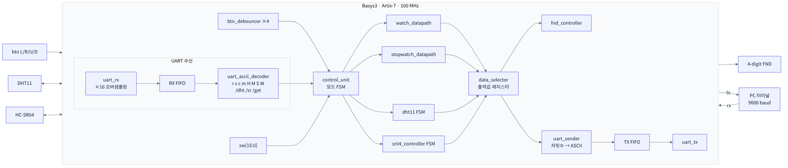
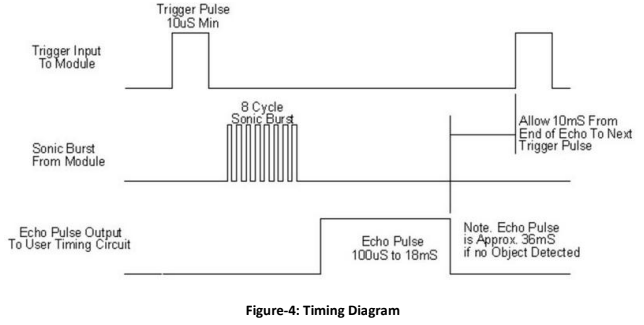
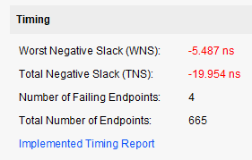
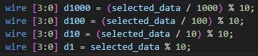
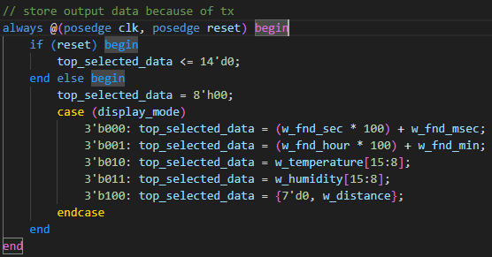
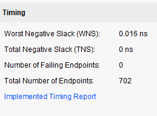

# FPGA UART Watch & Sensor System

Verilog로 구현한 Basys3 FPGA 기반 **시계 / 스톱워치 / 온습도(DHT11) / 초음파 거리(HC-SR04)** 통합 시스템입니다.
보드의 버튼·스위치뿐 아니라 PC의 **UART 명령으로도 모든 기능을 제어**할 수 있고, 현재 표시값을 UART로 PC에 전송합니다.
결과는 4자리 7-Segment(FND)에 표시됩니다.

## System Overview

## 주요 기능

| 기능 | 설명 |
|---|---|
| 시계 | 시/분/초 설정, `sw[15]`로 `초.밀리초` ↔ `시.분` 표시 전환 |
| 스톱워치 | Run/Stop/Clear, 10ms 단위 |
| 온습도 | DHT11 단선(1-wire) 통신 FSM으로 온도·습도 측정 |
| 거리 | HC-SR04 Trigger/Echo FSM, Echo 펄스 폭으로 cm 단위 거리 계산 |
| UART 제어 | 9600 baud, 16배 오버샘플링 RX, 명령어 디코더로 버튼과 동일한 제어 |
| UART 전송 | 현재 표시값을 4자리 ASCII + 개행으로 PC에 전송 (TX FIFO 사용) |

## 조작 방법

**스위치 (모드 선택)**

| 스위치 | 모드 |
|---|---|
| 모두 OFF | 시계 (설정 모드) |
| `sw[0]` | 스톱워치 |
| `sw[1]` | 온도 표시 |
| `sw[2]` | 습도 표시 |
| `sw[3]` | 거리 표시 |
| `sw[15]` | 시계 표시 전환 (`초.밀리초` / `시.분`) |

**UART 명령어**

| 입력 | 동작 | 입력 | 동작 |
|---|---|---|---|
| `r` | 스톱워치 Run | `H` | 시 +1 |
| `s` | 스톱워치 Stop | `M` | 분 +1 |
| `c` | 스톱워치 Clear | `S` | 초 +1 |
| `m` | 스톱워치 모드 전환 | `W` | 시계 모드 전환 |
| `/dht` | 온습도 측정 시작 | `/sr` | 거리 측정 시작 |
| `/get` | 현재 표시값을 UART로 전송 | | |

한 글자 명령은 바로 실행되고, `/`로 시작하는 문자열 명령은 FSM으로 한 글자씩 받아서 확인합니다.

## 시스템 구조

| 모듈 | 역할 |
|---|---|
| `top_merge.v` | Top 모듈 |
| `top_uart_controller.v` | UART RX/TX + RX/TX FIFO |
| `uart_rx.v` / `uart_tx.v` / `baud_tick_x16.v` | UART 송수신, 9600 × 16 baud tick |
| `uart_ascii_decoder.v` | ASCII 명령어 → 제어 펄스 |
| `uart_sender.v` | 표시값을 자릿수별 ASCII로 변환 후 TX FIFO에 push |
| `fifo.v` | 레지스터 기반 FIFO |
| `control_unit.v` | 버튼·스위치·UART 입력을 통합한 모드 FSM |
| `watch_datapath.v` / `stopwatch_datapath.v` | 시계 / 스톱워치 카운터 |
| `dht11.v` | DHT11 통신 FSM (START → WAIT → SYNC → DATA → STOP) |
| `sr04_controller.v` | HC-SR04 FSM (START → WAIT → COUNT → DISTANCE) |
| `data_selector.v` | 모드에 따라 FND / UART 출력 데이터 선택 |
| `fnd_controller.v` | 4자리 FND 다이나믹 구동 |
| `btn_debouncer.v` | 버튼 디바운싱 |

## 시뮬레이션

**HC-SR04**: 거리 = Echo High 시간(µs) / 58

| 계산식 | 파형 |
|---|---|
|  |  |

**UART + FIFO**: RX(명령 수신 → 디코딩), TX(값 → ASCII 변환 → 송신) 파형은 [`docs/sim/uart_controller`](docs/sim/uart_controller)에 있습니다.

## 트러블슈팅: Timing Violation (Negative Slack)

- **현상**: Implementation 후 **WNS −5.487 ns**, failing endpoint 4개 (100 MHz 기준)

  

- **원인**: Critical path가 `data_selector` → `uart_sender`로 이어지는 경로였음. 모드별 선택값을 계산하는 곱셈(`sec * 100 + msec`)과, 이를 다시 천/백/십/일의 자리로 나누는 **나눗셈·나머지 연산(`/ 1000`, `% 10` 등)이 한 클럭 안의 조합 논리로 연결**돼 지연이 커짐

  

- **해결**: 선택된 출력값(`selected_data`)을 **레지스터에 한 번 저장(파이프라인 분리)** 해서 곱셈 경로와 나눗셈 경로를 다른 클럭으로 나눔

  

- **결과**: **WNS +0.016 ns, failing endpoint 0** 으로 타이밍 만족

  

## 개발 환경

- Verilog HDL, Xilinx Vivado
- Digilent Basys3 (Xilinx Artix-7), 100 MHz 시스템 클럭
